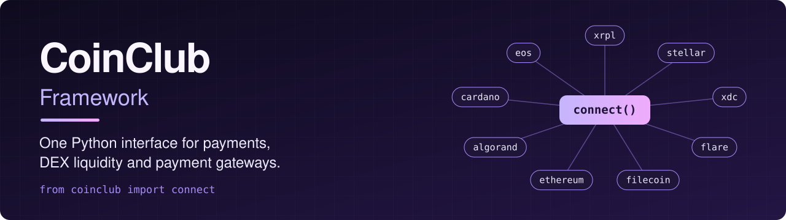
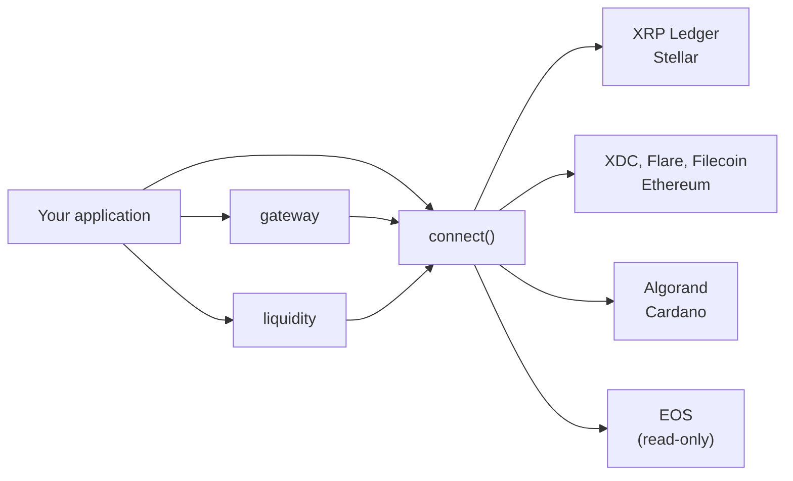
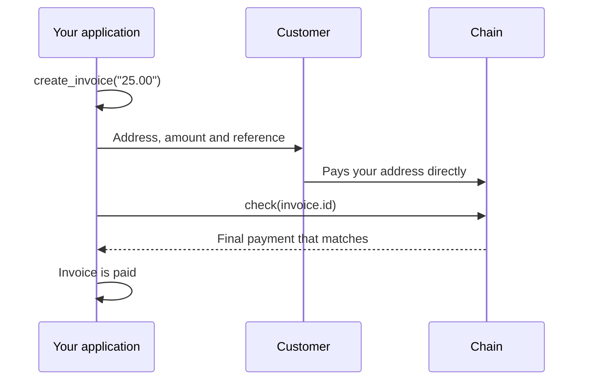

<div align="center">



# CoinClub Framework

**One Python interface for payments, DEX liquidity and payment gateways across multiple blockchains.**

<a href="https://github.com/CoinClubQuincy/CoinClub_Framework/actions/workflows/ci.yml"></a>
<a href="LICENSE"></a>


[Install](#install) · [Chains](#chains) · [Liquidity](#issue-a-token-and-provide-liquidity) · [Accept payments](#accept-payments) · [Metered API](#run-a-metered-api) · [Migration](docs/MIGRATION.md)

</div>

```python
from coinclub import connect

ledger = connect("xrpl")                 # Test network by default
alice = ledger.create_wallet()           # Generated locally
ledger.request_test_funds(alice)

bob = ledger.create_wallet()
ledger.request_test_funds(bob)

receipt = ledger.transfer(alice, bob.address, "1.5", reference="1001")
print(receipt.status, receipt.tx_id)
print(ledger.balance(bob.address))
```

Wallets, balances and transfers use the same calls across chains, so you can swap `"xrpl"` for `"stellar"`, `"xdc"` or `"algorand"`. Faucet funding with `request_test_funds` works only on `xrpl` and `stellar`, so fund test wallets on other chains yourself. [The table below](#chains) shows what each chain supports.

> [!WARNING]
> This software moves real money if you let it, and has had no independent security audit. It
> connects to test networks by default and refuses mainnet writes unless you pass
> `allow_mainnet=True`. Start on a test network.

## What is included

| Part | What it gives you |
|---|---|
| `connect()` | One wallet, balance and transfer interface, plus each chain's own features |
| `coinclub.liquidity` | Order book strategies: mean, bottom, top, stable and range |
| `coinclub.gateway` | Non-custodial invoices that settle from the chain itself |
| `coinclub.xaman` | Let users approve transactions in their own wallet |
| `coinclub.api` | A read-only AWS Lambda API with keys and monthly usage counts |
| `coinclub.aws` | Wallets from Secrets Manager or SSM, invoices and keys in DynamoDB |
| `coinclub` command | Wallets, balances, transactions, order books and ladders from a terminal |



## Chains

| Chain | `connect()` name | Wallets, balances, transfers | DEX and trust lines | Incoming payments and gateway | How it has been tested |
|---|---|---|---|---|---|
| XRP Ledger | `xrpl` | Yes | Yes | Yes | **Real transactions on testnet** |
| Stellar | `stellar` | Yes | Yes | Yes | **Real transactions on testnet** |
| XDC | `xdc` | Yes | No | No | In-process EVM, plus reads from Apothem |
| Flare and Songbird | `flare` | Yes | No | No | In-process EVM, plus reads from Coston2 |
| Filecoin (FEVM) | `filecoin` | Yes, with `0x` addresses only | No | No | In-process EVM, plus reads from Calibration |
| Ethereum | `ethereum` | Yes | No | No | In-process EVM, plus reads from Sepolia |
| Algorand | `algorand` | Yes | Asset opt-in only | Yes | Signing checked offline, plus reads from testnet |
| Cardano | `cardano` | Yes | No | No | Transactions built and signed offline against a fake node |
| EOS | `eos` | **Read-only** | No | No | Reads from mainnet |

"Real transactions" means the test suite sends them and checks the result on the live test network.
The chains without that have not had a transaction accepted by a real network through this library,
so try a small test payment first. EOS is read-only because signing needs ABI-aware Antelope
serialization that this library does not include.

The test suite has **250 offline tests** at 81% coverage, and **23 live tests** against public
networks, also scheduled to run weekly in CI.

## Install

```sh
pip install "coinclub[all] @ git+https://github.com/CoinClubQuincy/CoinClub_Framework"
```

Python 3.12 or newer. To install less, use only the extras you need: `xrpl`, `stellar`, `evm`,
`algorand`, `cardano` and `aws`. Cardano also needs a
[Blockfrost](https://blockfrost.io) project ID, passed as `api_key` or set in
`BLOCKFROST_PROJECT_ID`.

## Using real funds

Writes on a mainnet raise `MainnetNotAllowedError` unless you opt in:

```python
ledger = connect("xrpl", "mainnet", allow_mainnet=True)
```

Keep secrets out of your code. On AWS, load wallets from Secrets Manager or SSM:

```python
from coinclub.aws import wallet_from_secrets_manager

wallet = wallet_from_secrets_manager(ledger, "prod/treasury-wallet")
```

`Wallet` hides its secret from `repr()` and `str()`, so it stays out of ordinary logs. Amounts must
be `Decimal`, `str` or `int`; a `float` raises an error, because floats cannot represent money exactly.

## Chain-specific features

Every adapter also exposes what is unique to its chain.

```python
# XRP Ledger: any transaction type by name, and any rippled method
ledger.submit(wallet, "EscrowCreate", amount="1000000", destination=to, finish_after=when)
ledger.account_lines(account=address)

# XRP Ledger: multi-signing
tx = ledger.prepare_multisigned(account, "AccountSet", signers=2)
ledger.submit_multisigned(tx, [ledger.sign_for(a, tx), ledger.sign_for(b, tx)])

# Stellar: any operation
from stellar_sdk import ManageData
stellar.submit(wallet, [ManageData("key", "value")])

# EVM: any contract
contract = xdc.contract(address, abi)
contract.functions.totalSupply().call()
xdc.transact(wallet, contract.functions.mint(to, 100))

# Algorand: any algosdk transaction, including application calls
algorand.submit(wallet, txn)
```

## Issue a token and provide liquidity

XRP Ledger and Stellar have built-in order books. Both use the same calls:

```python
from coinclub import Asset
from coinclub.liquidity import mean, place_ladder

token = Asset("CCB", issuer.address)
ledger.add_trustline(holder, token)
ledger.transfer(issuer, holder.address, "1000", asset=token)

plan = mean(price="2", step="0.05", rungs=3, quantity="10")     # Plans only, touching no network
place_ladder(ledger, holder, plan, selling=token, buying=ledger.native)

ledger.order_book(token, ledger.native)
```

| Strategy | Prices |
|---|---|
| `mean(price, step, rungs, quantity)` | Centred on `price`, with `rungs` on each side |
| `bottom(price, step, rungs, quantity)` | Upward from `price` |
| `top(price, step, rungs, quantity)` | Downward from `price` |
| `stable(peg, width, rungs, quantity)` | Around a peg, where `width` is a fraction per rung |
| `from_range(low, high, rungs, quantity)` | Evenly across a range, such as a ticker's daily low and high |

Trading rules apply to you. Offers can be filled at any time once placed, and `place_ladder` leaves
earlier offers open if a later one fails.

`coinclub.exchange.BitrueClient` reads public market data from Bitrue. It never places orders.

## Accept payments

The gateway is non-custodial: it only reads the chain, and funds go straight to your address.

```python
from coinclub.gateway import PaymentGateway

gateway = PaymentGateway(ledger, my_address)
invoice = gateway.create_invoice("25.00")

# Show the customer invoice.address, invoice.amount and invoice.reference.
# The reference is a destination tag on XRPL, a memo on Stellar and a note on Algorand.

invoice = gateway.check(invoice.id)
if invoice.status == "paid":
    print(invoice.tx_id)
```



An invoice settles only on a final payment with the right address, reference and asset, for at
least the invoice amount, made during its validity period. On the XRP Ledger the delivered amount is
what counts, which blocks the partial payment exploit.

Invoices are kept in memory unless you pass a store, so use `coinclub.aws.DynamoInvoiceStore` in
production. `check` scans the most recent 200 payments to your address by default, so raise
`scan_limit` if yours is busy.

## Let users sign with Xaman

```python
from coinclub.xaman import XamanClient

xaman = XamanClient(api_key, api_secret)
payload = xaman.create_payload({"TransactionType": "Payment", "Destination": to, "Amount": "1000000"})
print(payload["next"]["always"])     # The user approves this in their wallet
```

Your server never holds the user's keys. The client also covers payload lookup and cancellation,
curated assets, KYC status, transaction lookup, rates and push notifications.

## Run a metered API

`coinclub.api` is a read-only AWS Lambda handler with API keys and per-month call counts for usage
billing. It never accepts or holds wallet secrets.

| Route | Returns |
|---|---|
| `GET /v1/chains` | Supported chains |
| `GET /v1/{chain}/{network}/balances/{address}` | Balances |
| `GET /v1/{chain}/{network}/transactions/{id}` | Transaction status |

Deploy it with the `serverless-api` blueprint from the
[AWS CloudFormation Infrastructure Library](https://github.com/CoinClubQuincy/AWS-CloudFormation-Infrastructure-Library),
using the handler `coinclub.api.handler`. Package the code and its dependencies as a ZIP for arm64,
then create keys with `coinclub.aws.DynamoApiKeys(table).create_key("customer")`. Counting calls is
all it does: charging customers is up to you. This handler has been tested locally against a mocked
AWS, not deployed.

## Command line

```sh
coinclub chains
coinclub wallet stellar --out my.wallet.json     # The file is readable only by you
coinclub balance xrpl rEXAMPLE --network mainnet
coinclub tx xrpl ABC123
coinclub book xrpl XRP USD:rISSUER --network mainnet
coinclub ticker XRPUSDT
coinclub ladder --strategy mean --price 2 --step 0.05 --rungs 3 --quantity 10
```

## Development

```sh
python3.12 -m venv .venv && source .venv/bin/activate
pip install -e ".[dev]"
pytest                # Offline
pytest -m live        # Real test networks and faucets. These can fail if a network is down
ruff check src tests
```

To add a chain, subclass `coinclub.chains.base.Chain` and register it in `coinclub/registry.py`.

## Upgrading from 0.0.9

Version 1.0 is a rewrite and is not compatible with earlier versions.
[`docs/MIGRATION.md`](docs/MIGRATION.md) maps the old functions to the new ones. The old code is in
[`legacy/`](legacy/) and tagged `v0.0.9-legacy`. Do not use it: it passes secrets through a shell.

## License

MIT. See [LICENSE](LICENSE).
